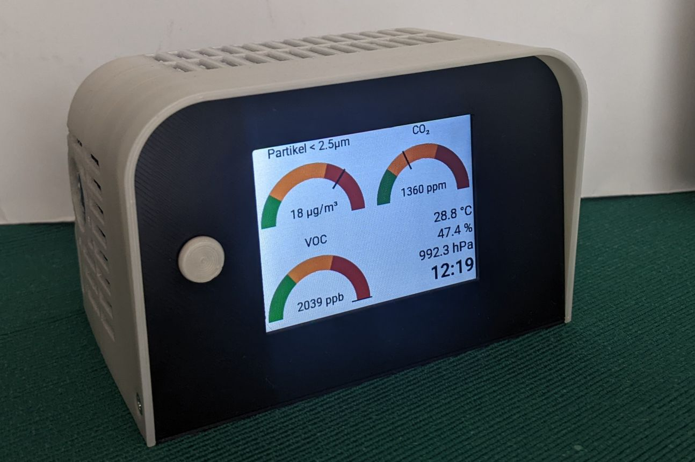

# Sensorbox v2
My customized configuration of Thomas Sanladerer's [Sensorbox v2](https://www.printables.com/model/1079858-3d-printer-emission-sensor-array-sensorbox-v2)

  

## Hardware
* Sensors: AHT20 + BMP280, SCD40, SGP30, PMS5003
* Display: ILI9341
* Controls: 1 Additional Button at GPIO35
* Custom case

## ESPHome configuration
* Customized new LVGL UI for available sensors
* Display sleep mode to prevent burn-in (activates when backlight is off)
* Show current time
* Additional front button functions:
  - Short press: Toggle display
  - Long press (10-15 sec): Factory reset
* No default WiFi credentials (uses ESPHome captive portal)

## License
Original work by Thomas Sanladerer licensed under [CC BY 4.0](https://creativecommons.org/licenses/by/4.0/).  
My modifications are also released under the same license.  
© [2024] Thomas Sanladerer (original)  
© [2025] tuwrraphael (modifications)